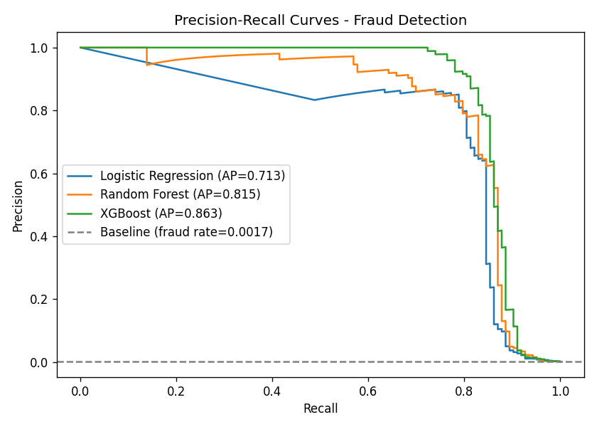
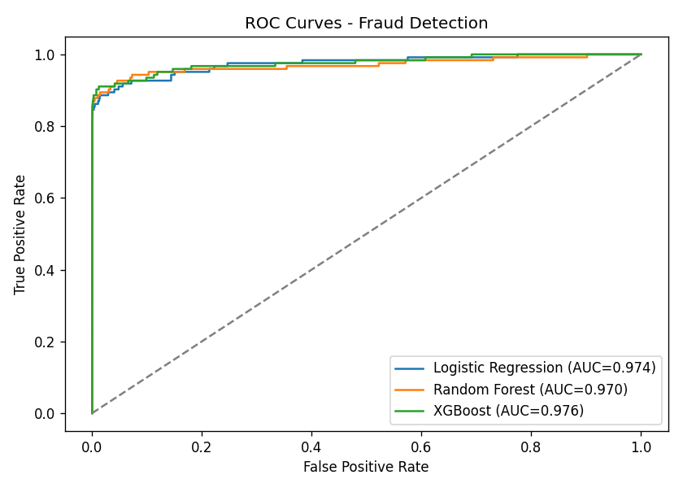
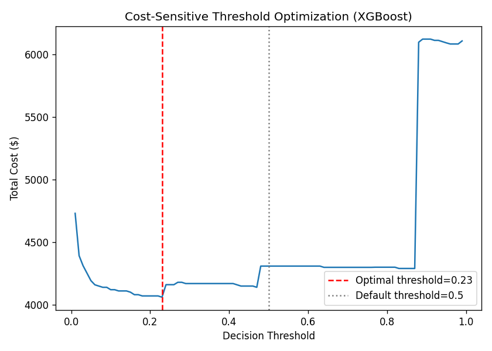

# Credit Card Fraud Detection

A Python machine learning project comparing Logistic Regression, Random Forest and XGBoost on highly imbalanced credit card transaction data.

## Approach

- Engineer elapsed-time hour-bin and day features. The hour bin is relative to the first transaction, not a verified local clock hour.
- Use a stratified 75/25 train/test split with random seed 42.
- Fit scaling on training data only.
- Apply SMOTE to Logistic Regression training data; use class weighting for Random Forest and XGBoost.
- Compare average precision (AP, labelled PR-AUC in the original summary) and ROC-AUC.
- Explore decision thresholds using an illustrative missed-fraud and false-alarm cost model.

## Reported results

These are the supplied historical results, not a new training run.

Dataset: 284,807 transactions, including 492 frauds (0.173%).

| Model | Average precision | ROC-AUC |
|---|---:|---:|
| Logistic Regression | 0.713285 | 0.974293 |
| Random Forest | 0.815219 | 0.970038 |
| XGBoost | 0.862975 | 0.976303 |




## Exploratory cost analysis

Assume each missed fraud costs its transaction amount and each false alarm costs 10 currency units. Original outputs display dollar symbols; these are illustrative units, not verified USD losses.

| Scenario | Estimated cost |
|---|---:|
| No detection | 13,269.38 |
| Default threshold 0.50 | 4,308.66 |
| Selected threshold 0.23 | 4,059.97 |

This represents a 69.4% reduction versus no detection and a 5.8% reduction versus the default threshold. Estimated savings versus no detection are 9,209.41 units.



**Evaluation limitation:** Both model choice and threshold selection use test-set results in this exploratory pipeline. The optimized cost is therefore optimistic and is not an unbiased held-out deployment estimate. Scaling and SMOTE are restricted to training data, but that alone does not make the entire evaluation leakage-free. A follow-up should select the model and threshold using validation data, then evaluate once on an untouched test set. A chronological split would also better simulate future transactions.

## Run locally

Use Python 3.10 or newer. Obtain the MLG-ULB credit card fraud dataset separately and place `creditcard.csv` in `data/`. The dataset is not included in this repository.

```bash
python -m venv .venv
```

Activate on Windows PowerShell:

```powershell
.venv\Scripts\Activate.ps1
```

Activate on macOS/Linux:

```bash
source .venv/bin/activate
```

Install dependencies and run:

```bash
python -m pip install -r requirements.txt
python fraud_detection_pipeline.py --data data/creditcard.csv --output-dir outputs
```

The script trains all three models and writes three charts and a text summary to `outputs/`. Training can take several minutes and SMOTE increases memory use. Dependencies are unpinned because the original environment versions were not supplied; exact numerical reproduction is not guaranteed.

## Repository contents

- `fraud_detection_pipeline.py`: runnable training and analysis script with configurable paths.
- `requirements.txt`: required Python packages.
- `results/`: supplied historical charts and summary.
- `.gitignore`: excludes datasets, environments, secrets and generated local outputs.

## Verification

The packaged script was checked for Python syntax. Training was not rerun because the dataset was not provided. No trained model or deployed inference service is included.
